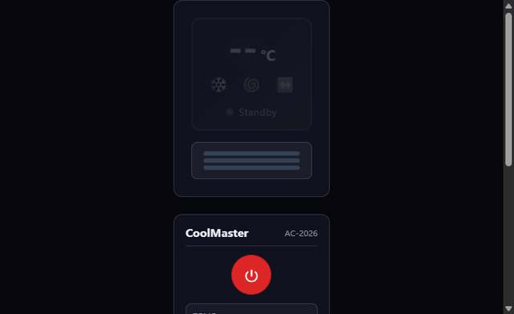
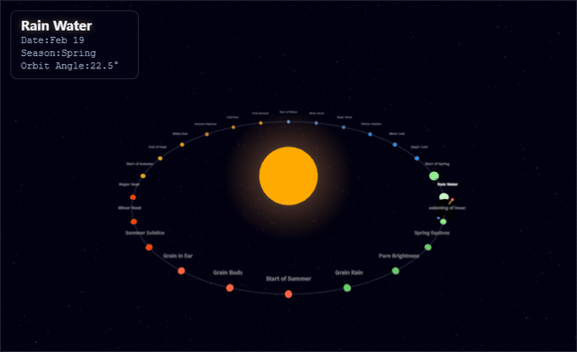
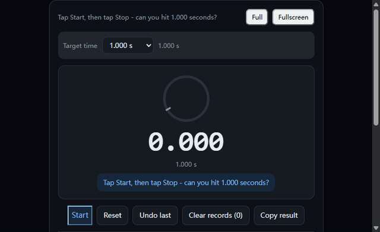

# FunToolX — 娱乐向趣味工具

[English version / 英文版本](README.md)

从 [FunToolX](https://funtoolx.com/en/) 精选出的一组**娱乐向趣味工具**——每个都是单文件自包含，零构建、零依赖、零统计脚本。

## Showcases

| # | 演示 | 预览 |
|---|------|--------|
| 1 | [虚拟空调](virtual-ac/) |  |
| 2 | [二十四节气](solar-terms/) |  |
| 3 | [64卦八卦](fractal-bagua/) |  |
| 4 | [一秒按压挑战](one-second-challenge/) |  |
| 5 | [拼豆像素图](bead-pixel/) |  |

## FunToolX 精选工具一键直达

每条都直达线上工具页，点开即用：

- [虚拟空调](https://funtoolx.com/en/tools/virtual-appliance/virtual-ac/) — 在线虚拟空调，温度、模式与白噪音
- [太阳系](https://funtoolx.com/en/tools/visual-effects/solar-system/) — 3D 太阳系，八大行星公转、土星环、行星标注与星空
- [二十四节气](https://funtoolx.com/en/tools/visual-effects/solar-terms/) — 地球公转经过二十四节气，固定地轴倾角、季节色彩与节气标记
- [分形八卦图](https://funtoolx.com/en/tools/visual-effects/fractal-bagua/) — 八卦分形递归，先后天八卦变换，层数与速度控制
- [一秒挑战](https://funtoolx.com/en/tools/games/one-second-challenge/) — 点击开始、再点击停止，看你能不能把秒表稳稳按在 1 秒上
- [按压浪费时间](https://funtoolx.com/en/tools/zen-tools/time-waster/) — "恭喜你浪费了 xx 秒"无聊解压神器
- [电子木鱼](https://funtoolx.com/en/tools/zen-tools/wooden-fish/) — 点击敲击木鱼，积德行善，支持自动连敲
- [电子上香](https://funtoolx.com/en/tools/zen-tools/incense-burner/) — 在线点燃香炉，烟雾飘动，静心祈福
- [电子水景](https://funtoolx.com/en/tools/zen-tools/aquarium/) — 金鱼缸喷泉溪流纯 CSS 动画水景
- [罗盘](https://funtoolx.com/en/tools/visual-effects/iching-compass/) — 多层罗盘：64 卦 + 八卦 + 二十四山 + 太极中心
- [爱心粒子计时器](https://funtoolx.com/en/tools/romance/heart-timer/) — 由粒子组成的大颗跳动爱心，支持自定义计时与留言
- [天灯](https://funtoolx.com/en/tools/romance/sky-lantern/) — 点击放飞发光的孔明灯，升到顶部炸成星光粒子，可自定义心愿
- [假新闻生成器](https://funtoolx.com/en/tools/pranks/fake-news-generator/) — 生成逼真的新闻头条截图
- [决策轮盘](https://funtoolx.com/en/tools/pranks/spinning-wheel/) — 自定义选项的幸运轮盘，帮你做决策
- [烟花文字](https://funtoolx.com/en/tools/visual-effects/firework-text/) — 烟花爆炸后粒子汇聚成文字，再散开
- [掷骰子](https://funtoolx.com/en/tools/games/dice-roller/) — 在线掷骰子，支持1-3个骰子

## License

MIT — the code is extracted from the FunToolX project for showcase purposes.
