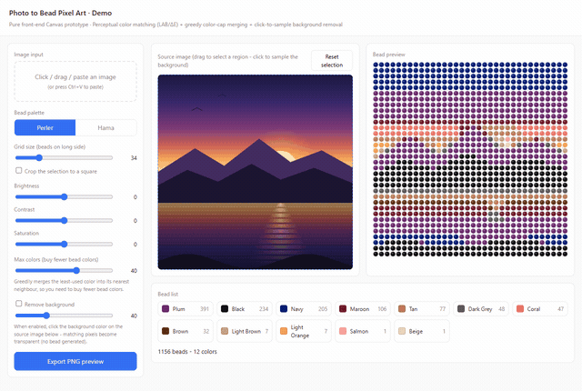

# Bead Pixel Art

Turn any photo into perler-bead pixel art

## Run it

Open `index.html` in any modern browser — no build, no install, no dependencies.

## How it works

The photo is downsampled onto a grid, each cell is matched to the nearest palette colour in LAB space (ΔE), and the result is painted as round beads.

The full implementation, controls and edge cases live on the live site — the snippet above is the core idea only.

## Live version

▶ **Live site** https://funtoolx.com/

> This tool is being integrated into funtoolx.com — the repo holds the full standalone implementation.

## More from FunToolX

A hand-picked selection of related tools — each one links straight to the live site:

- [Virtual AC](https://funtoolx.com/en/tools/virtual-appliance/virtual-ac/) — Online virtual air conditioner with temp, mode and white noise
- [Solar System](https://funtoolx.com/en/tools/visual-effects/solar-system/) — 3D solar system with 8 planets orbiting, Saturn rings, planet labels and starfield
- [24 Solar Terms](https://funtoolx.com/en/tools/visual-effects/solar-terms/) — Earth orbit through 24 solar terms with fixed axial tilt, seasonal colors and term markers
- [Fractal Bagua Pattern](https://funtoolx.com/en/tools/visual-effects/fractal-bagua/) — Bagua fractal recursion, pre-heaven and post-heaven trigram transformation, layer and speed control
- [One Second Challenge](https://funtoolx.com/en/tools/games/one-second-challenge/) — Tap start, tap stop — see if you can land your timing exactly on one second
- [Time Waster Press](https://funtoolx.com/en/tools/zen-tools/time-waster/) — "Congratulations you wasted xx seconds" boredom relief tool
- [Digital Wooden Fish](https://funtoolx.com/en/tools/zen-tools/wooden-fish/) — Tap to strike the wooden fish, accumulate merit, auto-strike supported
- [Digital Incense](https://funtoolx.com/en/tools/zen-tools/incense-burner/) — Light virtual incense online, smoke animation, peaceful prayer
- [Digital Aquarium](https://funtoolx.com/en/tools/zen-tools/aquarium/) — Goldfish tank fountain stream pure CSS animation waterscape
- [I-Ching Compass](https://funtoolx.com/en/tools/visual-effects/iching-compass/) — Multi-ring compass: 64 hexagrams + 8 trigrams + 24 mountains + Taiji center
- [Heart Particle Timer](https://funtoolx.com/en/tools/romance/heart-timer/) — Large pulsating heart made of particles with customizable timer and messages.
- [Sky Lantern](https://funtoolx.com/en/tools/romance/sky-lantern/) — Click to launch glowing lanterns that float upward and burst into starlight particles at the top. Customize your wish.
- [Fake News Generator](https://funtoolx.com/en/tools/pranks/fake-news-generator/) — Generate realistic news headline screenshots
- [Spinning Wheel](https://funtoolx.com/en/tools/pranks/spinning-wheel/) — Customizable lucky wheel to help you decide
- [Firework Text](https://funtoolx.com/en/tools/visual-effects/firework-text/) — Fireworks explode then particles converge into text, then disperse
- [Dice Roller](https://funtoolx.com/en/tools/games/dice-roller/) — Roll 1-3 dice online

---
MIT licensed.
